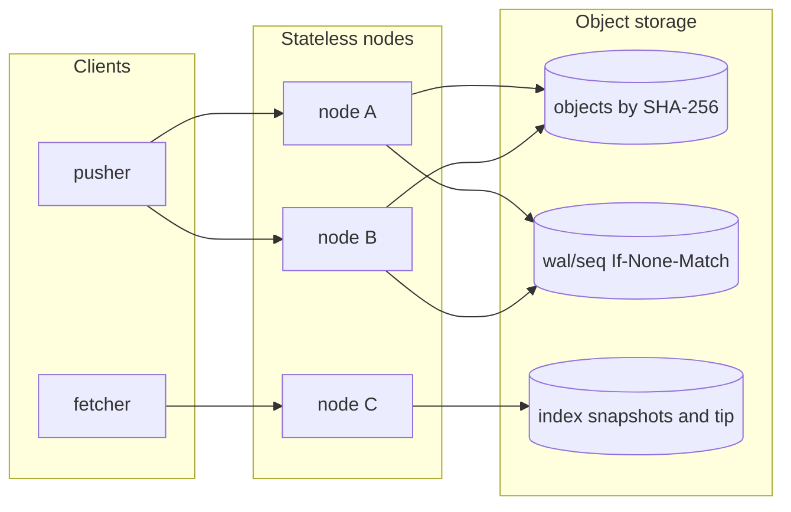
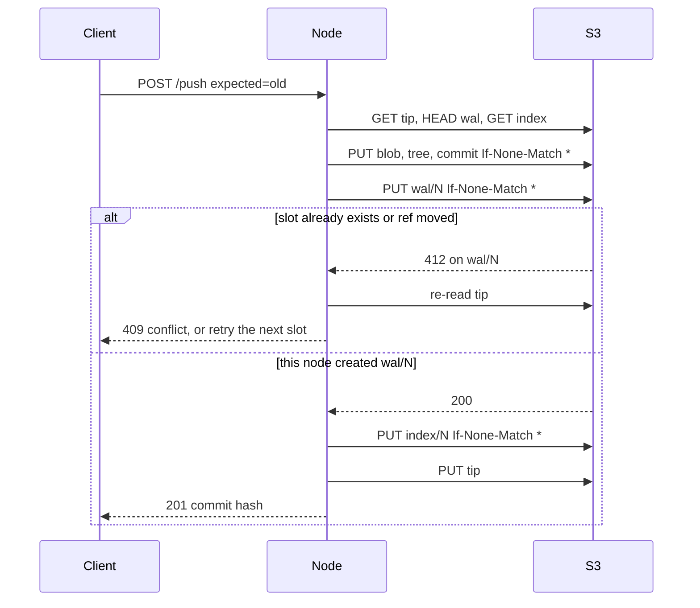
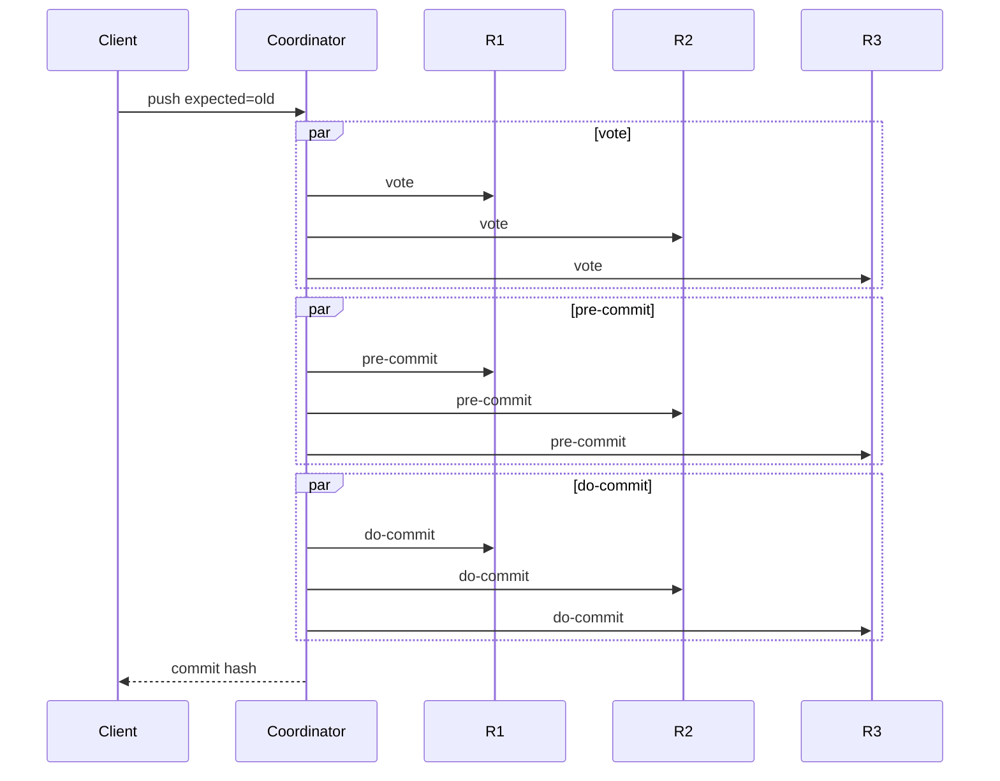

# Continuing Git Store

A small Java 21 Git host. The repository lives in a write-ahead log on S3-compatible storage. Nodes do not keep the repo. A ref moves only when a conditional put creates the next log slot, so two pushes cannot both win that slot.

This is an independent learning project inspired by Cursor's [Git at any scale](https://cursor.com/blog/git-at-any-scale) (Vicent Martí, August 2026), which describes Continuity: a WAL in object storage as the source of truth, stateless nodes, and ordering from atomic compare-and-swap instead of a 3-replica consensus protocol in the GitHub Spokes style. Nothing here is Continuity, Origin, or a drop-in Git server.

## What you can do with it

- Store content-addressed blobs, trees, and commits. The on-disk layout matches Git loose objects (`<type> <size>\0<payload>`), hashed with SHA-256.
- Advance a ref by appending one WAL entry. The put uses `If-None-Match: *`. The loser re-reads. If the ref still matches the client's expected commit, it tries the next slot. If not, the client gets a conflict and the ref is unchanged.
- Serve push and fetch from several HTTP nodes. Any node can take any request. A second process with the same bucket sees the same refs.
- Run the same push API against an in-memory backend or against MinIO.
- Compare that with an in-process 3-replica, three-phase commit store. Delay is an injected sleep, so the cost of the extra rounds is visible.
- Print a benchmark from a real run. The numbers in this file were produced by that program. They are not copied from the blog.

It does not speak the Git wire protocol, store packfiles, gossip over UDP, or compact the log. A production system such as Continuity batches WAL index updates and keeps a real Git repo on NVMe. This one does a handful of storage calls per push so the protocol is easy to read.

## Architecture



Objects are written first. The linearization point is the WAL put. The index and the tip pointer are caches. A reader that finds a missing index replays the log. A tip that is behind is probed forward. A tip that points past the log is walked back. After that, any node can build the ref map.



Keys for one repository:

```text
{repo}/objects/{sha256}
{repo}/wal/{seq}.json
{repo}/index/{seq}.json
{repo}/tip
```

`seq` is a 20-digit number. Entry N is valid only when it follows N-1 and its `expected` field matches the ref at N-1. That check is what makes a stale writer, the one who lost the slot, fail closed instead of forking history.

The 3-replica store is the contrast, not the serving path. A coordinator fans each push out to every live replica in three phases: vote, pre-commit, do-commit. The live set has to be a majority. Each phase waits for the slowest replica. Replicas hold the bytes themselves. There is no shared log. One replica can be down and a push still commits. Two cannot. If the coordinator stops after pre-commit, `recover()` finishes the transaction. If it stops before pre-commit, recovery drops the lock.



## Speed and scale, and what consensus is for

Both designs can keep a single linear history. The difference is where the atomic decision lives, and what you pay for it.

The WAL design decides order with one conditional create in the object store. Adding nodes does not add a phase to a push. A node can disappear. The next node reads the log. Conflicting pushes of the same ref do not queue: one wins the slot, the other gets a conflict and retries from the new tip. Different refs only contend for the next sequence number, and the loser retries.

What you give up is local-quorum availability. A push cannot commit while the object store is down, because the log is the source of truth. You also trust that `If-None-Match: *` is atomic. The in-memory backend implements that with `putIfAbsent`. MinIO and the AWS SDK path are covered by tests. This project also does not batch the index, so a push is several round trips. Continuity's blog describes batching specifically to avoid a one-PUT ceiling. The latency scenario below is this simpler shape, on purpose.

The 3-replica design decides order by talking to replicas you operate. A majority can still accept a push if one machine is down. The lock serializes a ref instead of failing the client, until the client's expected commit is stale, in which case the push conflicts the same way a Git compare-and-swap does. The cost is three rounds, each as slow as the slowest replica, and replicas that have to be repaired when they fall behind. The tail scenario is that cost with the sleep left in.

The ratios at the bottom of the benchmark are `pushes_per_sec` from this process divided by each other. Cursor's post reports about 120 pushes/s on S3 Standard and more than 300 on S3 Express for a real monorepo, with compaction and replication in the path. Those are not the numbers below.

## Run

Java 21 and Maven are enough for tests, the in-memory nodes, and the benchmark.

```bash
mvn test
mvn -DskipTests package
java -jar target/continuing-gitstore.jar benchmark
java -jar target/continuing-gitstore.jar demo
```

`demo` starts three nodes on ports 8080, 8081, and 8082. They share one in-memory store, so they only prove statelessness inside one process. Two processes need MinIO.

```bash
curl -s -X POST localhost:8080/v1/repos/demo/push \
  -H 'content-type: application/json' \
  -d '{"ref":"refs/heads/main","author":"ada","message":"hello","files":{"README.md":"hello\n"}}'

curl -s 'localhost:8081/v1/repos/demo/files?ref=refs/heads/main'
curl -s 'localhost:8082/v1/repos/demo'
```

A second push must send `expected` set to the commit hash from the first response. Omitting it, or sending a stale hash, returns 409 and leaves the ref where it was. `force: true` still takes one WAL slot, but it rebuilds the commit on whatever the ref points at when the slot is won.

HTTP routes:

| Method | Path | Role |
| --- | --- | --- |
| GET | `/health` | Node id |
| POST | `/v1/repos/{repo}/push` | Create a commit and move a ref |
| GET | `/v1/repos/{repo}` | Sequence and ref map |
| GET | `/v1/repos/{repo}/files?ref=refs/heads/main` | Files at that ref |
| GET | `/v1/repos/{repo}/log?ref=refs/heads/main&limit=20` | Newest commits first |
| GET | `/v1/repos/{repo}/objects/{sha256}` | One object |

MinIO, with three nodes in separate processes:

```bash
docker compose up --build
```

The MinIO image is compiled from git tag `RELEASE.2025-10-15T17-29-55Z`. That tag is AGPL and accepts S3 calls. The September 2026 AIStor binary we tried refuses every S3 call unless a license is installed, and the old `minio/minio` Docker Hub repository no longer resolves. The first `docker compose up` is slow because it compiles MinIO.

Point a node at a MinIO you already have:

```bash
java -jar target/continuing-gitstore.jar node \
  --port 8080 --node-id node-a --storage s3 \
  --endpoint http://127.0.0.1:9000 --bucket gitstore \
  --access-key minioadmin --secret-key minioadmin
```

The same endpoint flags work on `benchmark --minio`.

`GITSTORE_MINIO_ENDPOINT` turns on `MinioWalIT`. Without it, `mvn test` skips that class. The unit tests still drive the AWS SDK against an in-process S3 that checks `If-None-Match`.

## Benchmark

One run, not an average. Command:

```bash
java -jar target/continuing-gitstore.jar benchmark \
  --minio --endpoint http://127.0.0.1:9000 --bucket gitstore-bench
```

MinIO was the community server built from `RELEASE.2025-10-15T17-29-55Z`, listening on `127.0.0.1:9000`. The in-memory and 3PC scenarios do not use it. Exit code was 0. `history_ok=true` means the ref is one parent-linked chain and every tree and blob on it can be read.

```text
CONTINUING GIT STORE BENCHMARK
source=BenchmarkRunner in this repository, one process, one run
clock=System.nanoTime
rate=successes * 1000 / elapsed_ms
these numbers were measured here; they are not taken from the Cursor blog
timestamp=2026-11-04T15:37:04.176292387Z
java.version=21.0.12.1
java.vendor=Ubuntu
os.name=Linux
os.arch=amd64
os.version=6.12.94+
availableProcessors=4
cpu.model=Intel(R) Xeon(R) Processor
mem.total=16387280 kB

[warmup_wal_memory_not_a_result]
threads=1
attempts=200
successes=200
conflicts=0
errors=0
elapsed_ms=289.67
pushes_per_sec=690.43
attempts_per_sec=690.43
note=discarded from comparisons; it only exercises the JIT
history_ok=true
chain_length=200

[wal_memory_sequential]
threads=1
attempts=1500
successes=1500
conflicts=0
errors=0
elapsed_ms=140.22
pushes_per_sec=10697.71
attempts_per_sec=10697.71
storage_puts=9000
storage_gets=5997
storage_heads=2999
conditional_put_rejections=0
wal_append_losses=0
injected_put_delay_ms=0
injected_get_delay_ms=0
history_ok=true
chain_length=1500
head=1d2fb184f835ed9f441b9b4e65ffd31c806d84cde7391531124bcf74ad130947

[wal_memory_parallel_refs]
threads=8
attempts=1200
successes=1200
conflicts=0
errors=0
elapsed_ms=120.59
pushes_per_sec=9951.31
attempts_per_sec=9951.31
storage_puts=14176
storage_gets=11874
storage_heads=6814
conditional_put_rejections=6777
wal_append_losses=1744
history_ok=true
second_store_sees_same_snapshot=true

[wal_memory_same_ref_single_flight]
threads=32
attempts=32
successes=1
conflicts=31
errors=0
elapsed_ms=1.68
pushes_per_sec=595.47
attempts_per_sec=19055.17
storage_puts=6
storage_gets=63
storage_heads=63
conditional_put_rejections=0
wal_append_losses=0
history_ok=true
chain_length=1
head=0825a8b3c5239e9637b91748a7c47a4be2fd512a81b2d9aa46b0312bb70dc332
invariant_single_winner=true

[wal_memory_same_ref_retry]
threads=8
attempts=349
successes=200
conflicts=149
errors=0
elapsed_ms=13.95
pushes_per_sec=14341.36
attempts_per_sec=25025.67
storage_puts=1672
storage_gets=2274
storage_heads=1677
conditional_put_rejections=354
wal_append_losses=118
client_conflicts_from_store=149
history_ok=true
chain_length=200
head=26ad4b6d35317593d10b7dbee794e0dd6869133d2cac2844562de5a6575fcb51
second_store_sees_same_snapshot=true

[wal_memory_put3ms_get1ms_sequential]
threads=1
attempts=40
successes=40
conflicts=0
errors=0
elapsed_ms=1018.73
pushes_per_sec=39.26
attempts_per_sec=39.26
storage_puts=240
storage_gets=157
storage_heads=79
conditional_put_rejections=0
wal_append_losses=0
injected_put_delay_ms=3
injected_get_delay_ms=1
history_ok=true
chain_length=40
head=178071230f27a19acd35e3f444249a5a23f0c611512330972bed14d7784eb0d5
delay_floor_ms=504.00

[wal_http_three_nodes_round_robin]
threads=1
attempts=200
successes=200
conflicts=0
errors=0
elapsed_ms=3292.29
pushes_per_sec=60.75
attempts_per_sec=60.75
nodes_agree=true
node_heads=200:ac16b00e61e9c083118f92481d1204d9d7e5e2697fc30c79238f9f0e6bb448ec 200:ac16b00e61e9c083118f92481d1204d9d7e5e2697fc30c79238f9f0e6bb448ec 200:ac16b00e61e9c083118f92481d1204d9d7e5e2697fc30c79238f9f0e6bb448ec
history_ok=true
chain_length=200

[consensus_3pc_delay0_sequential]
threads=1
attempts=300
successes=300
conflicts=0
errors=0
elapsed_ms=55.49
pushes_per_sec=5406.16
attempts_per_sec=5406.16
consensus_commits=300
consensus_client_conflicts=0
consensus_retries=0
mean_vote_ms=0.05
mean_precommit_ms=0.03
mean_docommit_ms=0.04
replicas_agree=true
replica_delays_ms=0,0,0
history_ok=true
chain_length=300

[consensus_3pc_delay5ms_sequential]
threads=1
attempts=40
successes=40
conflicts=0
errors=0
elapsed_ms=674.40
pushes_per_sec=59.31
attempts_per_sec=59.31
consensus_commits=40
consensus_client_conflicts=0
consensus_retries=0
mean_vote_ms=5.59
mean_precommit_ms=5.56
mean_docommit_ms=5.53
replicas_agree=true
replica_delays_ms=5,5,5
history_ok=true
chain_length=40
delay_floor_ms=420.00
delay_floor_meaning=0.70 * pushes * 3 phases * slowest replica sleep

[consensus_3pc_tail_5_5_25ms_sequential]
threads=1
attempts=25
successes=25
conflicts=0
errors=0
elapsed_ms=1926.86
pushes_per_sec=12.97
attempts_per_sec=12.97
consensus_commits=25
consensus_client_conflicts=0
consensus_retries=0
mean_vote_ms=25.58
mean_precommit_ms=25.61
mean_docommit_ms=25.59
replicas_agree=true
replica_delays_ms=5,5,25
history_ok=true
chain_length=25
delay_floor_ms=1312.50
delay_floor_meaning=0.70 * pushes * 3 phases * slowest replica sleep

[consensus_3pc_same_ref_single_flight]
threads=16
attempts=16
successes=1
conflicts=15
errors=0
elapsed_ms=0.61
pushes_per_sec=1643.77
attempts_per_sec=26300.26
consensus_commits=1
consensus_client_conflicts=15
consensus_retries=0
mean_vote_ms=0.07
mean_precommit_ms=0.04
mean_docommit_ms=0.07
replicas_agree=true
history_ok=true
chain_length=1
head=2a95779ae4db76385cf0d133ed5436a6afc7fdf85fb359a999237fe760e812cc
invariant_single_winner=true

[minio_sequential]
threads=1
attempts=30
successes=30
conflicts=0
errors=0
elapsed_ms=707.13
pushes_per_sec=42.43
attempts_per_sec=42.43
storage_puts=180
storage_gets=117
storage_heads=59
conditional_put_rejections=0
endpoint=http://127.0.0.1:9000
bucket=gitstore-bench
history_ok=true
chain_length=30
reader_is_a_second_store=true
wal_append_losses=0

[minio_same_ref_retry]
threads=4
attempts=42
successes=20
conflicts=22
errors=0
elapsed_ms=1108.75
pushes_per_sec=18.04
attempts_per_sec=37.88
storage_puts=200
storage_gets=290
storage_heads=217
conditional_put_rejections=60
history_ok=true
chain_length=20
endpoint=http://127.0.0.1:9000

[derived_from_the_rates_above]
wal_sequential_over_consensus_delay0=1.98
wal_sequential_over_consensus_with_injected_delay=180.37
derivation=ratio of the pushes_per_sec values printed above
```

How to read that run:

- In memory, one thread committed 1500 pushes in 140.22 ms, 10697.71 pushes/s. That is 9000 puts, 6 per push: blob, tree, commit, WAL entry, index, tip. No conditional put was rejected.
- Eight threads on eight refs committed all 1200 pushes and a second `WalRefStore` on the same map saw the same snapshot. `wal_append_losses=1744` is how often two threads tried to create the same next slot. `conflicts=0` because a lost slot is retried inside the store when the caller's ref has not moved. `conditional_put_rejections` is higher because a retry also re-puts objects that are already stored.
- Thirty-two threads creating the same ref produced 1 success and 31 conflicts. On this run the losers observed the new tip and returned 409 without losing a slot (`wal_append_losses=0`). A unit test holds every thread on the put and checks that 23 of 24 lose `If-None-Match`.
- Eight threads retrying until each had landed 25 commits produced 200 successes, 149 conflicts, and a chain of length 200. A second store saw the same head.
- Sleeping 3 ms on every put and 1 ms on every get or head dropped a sequential push to 39.26/s. The counters say 240 puts and 236 reads. `240 * 3 + 236 * 1 = 956` ms of injected sleep. The measured elapsed time was 1018.73 ms.
- Two hundred HTTP pushes round-robined across three nodes. All three GETs returned commit `ac16b00e61e9c083118f92481d1204d9d7e5e2697fc30c79238f9f0e6bb448ec`.
- With no injected delay, the 3PC simulator did 300 pushes at 5406.16/s. The in-memory WAL did 10697.71/s on the same machine. The printed ratio is 1.98.
- At 5 ms per replica per phase, 3PC fell to 59.31 pushes/s. Mean vote, pre-commit, and do-commit were 5.59 ms, 5.56 ms, and 5.53 ms.
- With replica sleeps of 5 ms, 5 ms, and 25 ms, mean phase time sat on the slow replica (25.58, 25.61, 25.59 ms) and throughput was 12.97 pushes/s. Fan-out is parallel, so the phase waits for the tail, not for the sum of the replicas.
- Sixteen concurrent creators against 3PC also had a single winner: 1 success, 15 conflicts, and the three replicas agreed.
- Against localhost MinIO, 30 sequential pushes took 707.13 ms (42.43/s) and a second store read the same chain. Four threads retrying on one ref landed 20 commits, hit 22 conflicts, and left a chain of length 20.

## Tests and CI

`mvn test` covers object hashing, conditional puts, fast-forward and conflict, log replay when the index and tip are removed or wrong, concurrent creators across two stores, retried pushes that stay one chain, distinct refs, the 3PC quorum (one replica down, two down, pre-commit recovery, vote rollback, a slow replica), and HTTP nodes. GitHub Actions runs that suite on Java 21, then builds MinIO from the tag above and runs `MinioWalIT`.

## Layout

```text
src/main/java/dev/continuing/gitstore
  model        loose objects, push command, outcomes
  storage      memory, counting, latency, S3
  wal          conditional append and replay
  consensus    3-replica, 3-phase simulator
  http         JDK HTTP server, one store per node
  bench        the measured run
docker/minio   community MinIO build
```
